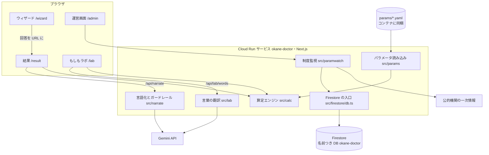
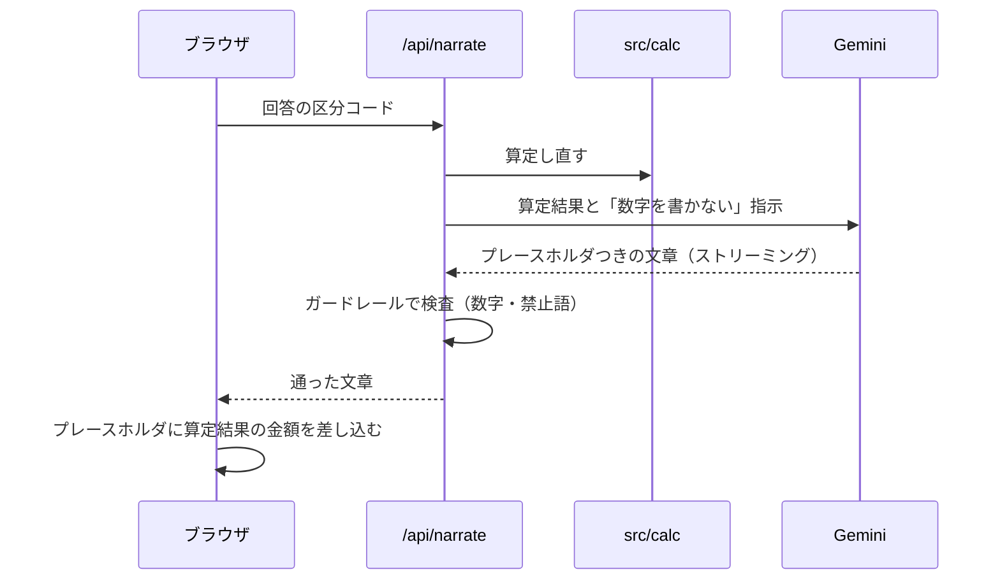

# ARCHITECTURE — お金の町医者（okane-doctor）

コンセプトと全体像は [README.md](README.md)。ここは構成の詳細です。
データモデルは [`docs/データモデル図.md`](docs/データモデル図.md)。[`docs/アーキテクチャ図.html`](docs/アーキテクチャ図.html) は前身の okane-kenko（2026-09-21）時点の図で、Slack 通知と定期実行がつながっているなど、いまの okane-doctor とは違う箇所があります。

## 設計の原則

1. **金額を作るのは `src/calc/` だけ。** 画面にも AI にも金額を作らせない。画面に出る円・万円はすべて算定結果から描く
2. **AI は言葉だけを扱い、副作用を持たない。** 文章はプレースホルダつきで返させ、ガードレールで検査し、落ちたら捨てる
3. **制度の数字は `params/*.yaml` だけに置く。** 出典・有効期間・verified を持たせ、期限切れなら診断を止める
4. **回答はサーバに保存しない。** 回答は URL のクエリ（区分コード）に載せ、金額は載せない
5. **壊れたら止まる。** 設定が足りない・値が古いときは、黙って続けずにエラーで止める

## 構成

| 置き場所 | 役割 |
|---|---|
| `app/` | 画面（LP・ウィザード・結果・もしもラボ・運営画面）と API ルート |
| `src/calc/` | 算定エンジン。死亡・医療・休職・失業の試算、レンジ、過不足の判定（`verdict3.ts`）、ラボの再計算（`lab.ts`） |
| `src/params/` | `params/*.yaml` の読み込みと有効期限・verified の確認 |
| `src/wizard/` | 回答の区分コードとエンジン入力の対応、回答の幅の包絡 |
| `src/narrate/` | AI の言語化（ストリーミング）とガードレール（数値・禁止語・自己評価語の検査） |
| `src/lab/` | もしもラボの言葉を、決まった前提の項目への変更に翻訳する |
| `src/paramwatch/` | 制度監視。一次情報の取得 → 抽出 → 台帳との比較 → 変更提案 |
| `src/watch/` | 世帯側の気づき通知（okane-doctor ではつないでいない。下の「つないでいないもの」） |
| `src/firestore/db.ts` | Firestore の入口。データベース名は `FIRESTORE_DATABASE_ID` から読み、未設定なら止まる |
| `src/design/` | デザイントークン（UI はセマンティックトークンだけを参照する） |

## 処理の流れ

### 診断と結果

1. ウィザードの回答を、区分コードの URL クエリにする（例：年収は `inc=lt600`）。金額は載せない
2. `/result` が `src/calc` を呼び、必要額・支え・過不足の判定を出す。区分で答えた項目は、区分の両端と内側の極値まで回して幅（レンジ）にする
3. 画面は算定結果から図（段差・滝・数直線）と金額を描く。算定基準日・パラメータの版・前提・出典もここで出す

### AI の言語化（「この結果のよみとき」）

検査に落ちたら文章を捨て、定型文に退きます。鍵が無いときも定型文です。

### もしもラボ

- 年齢スライダー・配偶者の働き方・病気やけがのシナリオは、サーバで算定済みのデータ（`calculateLab`）を引くだけです
- **言葉での入力**（`/api/lab/words`、[ADR-028](docs/ADR.md)）：AI に渡すのは区分コードと利用者の言葉だけで、返させるのは前提の列挙値の JSON だけです。中身はコードで検査し、「こう受け取りました」の文もコードの表から作ります。翻訳できない言葉（家計の相談・商品の質問など）には答えません。利用者の言葉は保存もログ出力もしません

### 制度監視

1. `params/watch-sources.yaml` に並べた一次情報のページを取得する
2. 見出しを手がかりに値を抽出する。違う金額が2件取れたら `ambiguous` で止まる
3. 台帳の値と違えば、変更提案を Firestore に積む
4. 運営画面（合言葉つき）で人が確かめて承認する。承認は「人が確認した」という記録で、システムは `params/` を書き換えない。値の反映は、人が YAML を直して PR を出す

## 実行環境とデプロイ

| サービス | 用途 |
|---|---|
| Cloud Run | アプリの実行（サービス `okane-doctor`・`asia-northeast1`・最小0台） |
| Cloud Build | `main` への push でビルド・デプロイ（トリガー `deploy-doctor`、定義は [`cloudbuild.yaml`](cloudbuild.yaml)） |
| Artifact Registry | コンテナイメージ。タグにコミットの SHA を付け、どのコミットが動いているかを追えるようにする |
| Firestore | 制度監視の提案と承認の記録（名前つきデータベース `okane-doctor`） |
| Secret Manager | Gemini の鍵と運営画面の合言葉 |
| Gemini API | 言語化と、ラボの言葉の翻訳 |

- 実行アカウントは okane-doctor 専用です
- 同じ GCP プロジェクトに、前身の okane-kenko（サービス `okane-kenko`・既定の Firestore）が動いています。`cloudbuild.yaml` のサービス名の既定値・実行アカウント・データベース名を okane-doctor に固定し、**okane-kenko には触らない**ようにしています
- 公開 URL はリポジトリに書かず、トリガーの置換変数で渡します

### つないでいないもの

| もの | 理由 |
|---|---|
| Slack への気づき通知・保存（お知らせ） | okane-kenko と同じ通知が2回飛ぶのを避けるため。保存は、本人が記録を消せる道ができるまで止めている（`src/watch/availability.ts`） |
| 定期実行（Cloud Scheduler） | 定期実行の合言葉を渡していないので、`/api/paramwatch/run`・`/api/watch/run` は 401 を返す |

## 環境変数

<!-- 変数名だけ。値は書かない -->

| 変数名 | 用途 | 置き場所 |
|---|---|---|
| `GEMINI_API_KEY` | AI の言語化・ラボの言葉の翻訳 | .env.local／Secret Manager |
| `GEMINI_MODEL` | モデル名（任意・秘密ではない） | .env.local |
| `ADMIN_PASSWORD` | 運営画面の合言葉 | .env.local／Secret Manager |
| `FIRESTORE_DATABASE_ID` | Firestore のデータベース名（秘密ではない） | .env.local／`cloudbuild.yaml` |
| `SITE_URL` | 共有画像の絶対 URL の基点（ビルド時） | トリガーの置換変数 |
| `SLACK_WEBHOOK_URL`・`WATCH_CRON_SECRET`・`WATCH_BASE_URL` | 気づき通知・定期実行（okane-doctor では未設定） | — |
| `NTFY_TOPIC` | CI 失敗の通知 | GitHub のシークレット |

## 品質の仕組み

| 仕組み | 何を守るか |
|---|---|
| ゴールデンテスト（`src/__tests__/`） | 10世帯の金額。期待値の正本は `docs/算定テスト_10世帯.xlsx` |
| `src/calc/verdict3.test.ts` | 過不足の判定の規則 |
| `src/narrate/guard.ts` とそのテスト | AI 出力の数値・煽り・自己評価語の混入 |
| Playwright（`e2e/`） | モバイル幅での一連の操作 |
| pre-commit（`.githooks/`） | lint・型チェック・テストが落ちたら commit させない |
| エージェントのフック（`.claude/hooks/`） | 履歴を壊す git 操作・`.env` の読み取り・秘密の出力をブロック |
