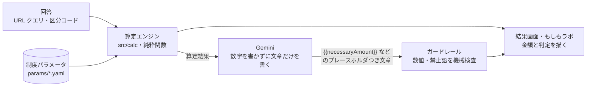
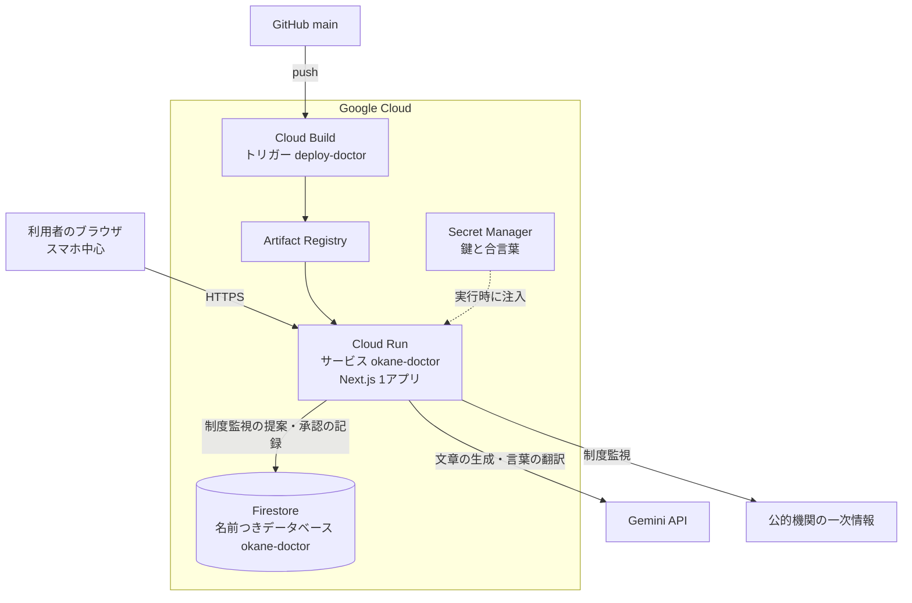

# お金の町医者（okane-doctor）

**家計の「もしも」を、根拠つきで診るアプリです。**
万一のときに家族の暮らしを支えるお金がいくら要るかを、公的制度の数字から幅（レンジ）で出し、いまの保障と比べます。
結果を見て気になったところは、「もしもラボ」で前提を変えて確かめられます。

保険は売りません。**必要ないなら「入らなくていい」と言えること**を、このアプリの芯にしています。

> 前身の [nekoai-lab/okane-kenko](https://github.com/nekoai-lab/okane-kenko)（`e35a072`）から作り直したものです。

---

## コンセプト

### なぜ「町医者」なのか

風邪をひいたら、近所の医者に行って、話を聞いてもらい、診てもらう。詳しい検査が要るところは「要る」と言ってもらえる。
お金の町医者は、その距離感で使える診断を目指しています。

- **まず診る。** 家族・働き方・収入・住まい・いまの保障を答えると、算定エンジンが必要額と過不足を出します
- **精査が要るところは、要ると言う。** 結果はいつも「概算・要精査」です。計算できないリスクは数字で埋めずに「未算定」と出します
- **「何でも診る」とは言わない。** 家計全体の最適化、投資の助言、保険商品の良し悪しは扱いません

### 体験の芯：伝える → 診断を受ける → 結果を理解する → もしもラボで確かめる

診断を一度きりで終わらせません（[ADR-025](docs/ADR.md)）。

| 段階 | 何をするか | 画面 |
|---|---|---|
| ① 伝える | 6つのステップで世帯のことを答える。分からない項目は「分からない」で進める | `/wizard` |
| ② 診断を受ける | 6つのリスクについて、必要額・公的制度などの支え・いまの保障を比べ、過不足の判定を出す | `/result` |
| ③ 結果を理解する | 段差・滝・数直線の図で、金額がどこから来たかをたどる。前提と出典を開示し、AI が文章で読み解く（数字はエンジンのもの） | `/result` |
| ④ もしもラボで確かめる | 万一の年齢、配偶者の働き方、病気やけがの種類を変えて、結論がどう動くかを見る。言葉で前提を変えることもできる | `/lab` |

ラボの数字は**すべて算定エンジンの再計算**です。言葉での入力も、AI は**言葉を前提の変更に翻訳するだけ**で、金額と判定は書きません（[ADR-028](docs/ADR.md)）。

### 診る範囲：6つのリスク

| リスク | 精度 |
|---|---|
| 死亡（本人） | 計算済み（遺族年金・団信・教育費などを積み上げる） |
| 死亡（配偶者） | 計算済み（配偶者がいる世帯のみ） |
| 病気・けが（短期） | 制度式で概算（高額療養費・傷病手当金） |
| 病気・けが（長期休職） | 制度式で概算（傷病手当金は通算1年6か月まで） |
| 就業不能・障害 | **未算定**（数字を置かず、そう明示する） |
| 失業 | 制度式で概算（会社員の雇用保険の基本手当。自営・公務員は未算定） |

扱わないもの：家計全体の最適化、投資の助言、介護・学資の備え、保険商品の良し悪し（[ADR-026](docs/ADR.md)）。

### 中立であるための事業の形

> 中立は、払い手が"商品の成約"でないときだけ本物になる。

想定する提供の形は、**法人の福利厚生**です。収益は勤務先からの PEPM（従業員1人あたり月額）で、**保険の成約手数料を取りません**。
払い手が保険を売って得をしない構造なので、不足する人には「準備してください」と、足りている人には「入らなくていい」と、同じ根拠で言えます。
対象は保険の加入・未加入を問いません（[ADR-027](docs/ADR.md)）。

そのため、次のことは**実装しません**（[CLAUDE.md](CLAUDE.md)「絶対にやらないこと」）。

- 保険商品名・保険会社名を出す（比較表・ランキングを含む）
- 保険の申込ページへの送客リンクを置く
- 成約額・手数料に連動する指標を持ち込む
- 不安を煽る表現を使う
- AI に金額を作らせる
- 制度の数字をコードに直接書く

---

## しくみ

### 金額を作るのはエンジンだけ。AI は言葉にするだけ



| 層 | 役割 | やってはいけないこと |
|---|---|---|
| 算定エンジン `src/calc/` | **金額を作る唯一の場所**。決定的な計算式 | 外部サービスへの依存 |
| AI（Gemini） | 算定結果を平易な日本語にする／ラボで言葉を前提の変更に翻訳する | 数値を書く・判断する・商品を語る |
| ガードレール `src/narrate/guard.ts` | AI の出力を機械的に検査し、落ちたら捨てる | — |

- **AI の出力には数値を書かせません。** `{{necessaryAmount}}` のようなプレースホルダだけを書かせ、画面が算定結果を差し込みます。ストリーミングの途中でも検査でき、金額が構造的に間違えようがありません
- **AI に副作用を持たせません。** 保存・送信・削除の手段を渡さないので、検査に落ちた出力は捨てるだけで済みます
- **鍵が無くても診断は成り立ちます。** AI を呼べないときは定型文に退き、ラボの言葉の入力は出しません

### 制度の数字は、出典つきの台帳に置く

遺族年金・高額療養費・傷病手当金などの値は、すべて `params/*.yaml` に **値・単位・出典・有効期間・verified フラグ** をそろえて置きます。
コードに数字を書かないので、制度が変わったときに直す場所は1つです。

- 公式に印刷された額を写し、式からの自前導出値は置きません
- **期限切れの中核パラメータでは診断を止めます。** 古い値で黙って金額を出し続けるより、止まるほうを選びます
- 公的出典のない値（遺族生活費率・手取り率など）は「当社基準」と画面にも明示します

### 制度の変化を見張る（制度監視）

`src/paramwatch/` は、一次情報のページを読みに行き、台帳の値との差を見つけると**変更の提案**を作ります。
提案は運営画面の承認キュー（`/admin/proposals`）に積まれます。**監視は提案を積むところまでで、`params/` を書き換えません。** 人が一次情報を確かめ、YAML を直す PR を出して初めて計算に入ります。
読み違いに備えて、同じ種類の表が複数あるページでは値ではなく見出しを手がかりにし、違う金額が2件取れたら止まります。

### 正しさの物差し：ゴールデンテスト

10の架空世帯について、手で検算した期待値（[`docs/算定テスト_10世帯.xlsx`](docs/算定テスト_10世帯.xlsx)）をテストに写しています。
**テストが落ちたら、期待値ではなくまず実装を疑います。** 期待値を変えるのは、正本の検算そのものが変わったときだけです。

---

## システム構成



- **アプリ**：Next.js（App Router）の1アプリを、Cloud Run の1サービス `okane-doctor` で動かします。リージョンは `asia-northeast1`
- **デプロイ**：`main` に入ると Cloud Build トリガー `deploy-doctor` がビルドして Cloud Run に出します（[`cloudbuild.yaml`](cloudbuild.yaml)）
- **データ**：回答は URL のクエリに区分コードで持ち、サーバに保存しません。Firestore には制度監視の提案と承認の記録だけを置きます。データベースは専用の名前つきデータベースで、実行アカウントも専用です
- **秘密**：Gemini の鍵と運営画面の合言葉は Secret Manager から渡し、リポジトリには置きません

詳しくは [ARCHITECTURE.md](ARCHITECTURE.md)。

### 技術スタック

| 分類 | 使っているもの |
|---|---|
| アプリ | Next.js 15（App Router）・React 19・TypeScript（strict） |
| 入力検証 | zod |
| 制度パラメータ | YAML（`yaml`） |
| AI | Gemini API |
| データ | Firestore（`firebase-admin`） |
| 実行・配信 | Cloud Run・Cloud Build・Artifact Registry・Secret Manager |
| 品質 | Vitest（ゴールデンテストほか）・Playwright（モバイル E2E）・Biome（Formatter / Linter） |
| デザイン | デジタル庁デザインシステムの判定色・フォーカスリングを土台にしたトークン（`src/design/tokens.css`） |

---

## 動かす

Node.js 22 を前提にしています。

```bash
npm ci
npm run dev        # http://localhost:3000
```

AI の文章とラボの言葉の入力を試すときは、`.env.example` を見て `.env.local` に `GEMINI_API_KEY` を置きます。
置かなくても、診断・結果・もしもラボの計算はすべて動きます。

| 用途 | コマンド |
|---|---|
| lint | `npm run lint` |
| 型チェック | `npm run typecheck` |
| テスト | `npm test`（ゴールデンテスト10世帯ほか） |
| E2E | `npm run test:e2e`（Playwright・モバイル） |
| ビルド | `npm run build` |

`npm ci` が Git の pre-commit フックを有効にします。lint・型チェック・テストのどれかが落ちると commit できません。

## リポジトリの歩き方

```
app/             画面（LP・ウィザード・結果・もしもラボ・運営画面）と API
src/calc/        算定エンジン（金額を作る唯一の場所。純粋関数）
src/lab/         もしもラボの言葉の翻訳（AI は前提の列挙値だけを返す）
src/narrate/     AI の言語化とガードレール
src/paramwatch/  制度監視（一次情報 → 変更提案 → 人の承認）
src/params/      制度パラメータの読み込みと有効期限の確認
params/          制度パラメータ（YAML・出典と有効期間つき）
src/design/      デザイントークン
src/__tests__/   ゴールデンテスト
docs/            仕様・決定の記録・用語集・設計資料
```

| 読みたいこと | 文書 |
|---|---|
| 開発のルール（AI エージェントも人も） | [CLAUDE.md](CLAUDE.md) |
| 構成の詳細 | [ARCHITECTURE.md](ARCHITECTURE.md) |
| 決定の記録 | [docs/ADR.md](docs/ADR.md) |
| 用語集 | [docs/CONTEXT.md](docs/CONTEXT.md) |
| 仕様 | [docs/SPEC.md](docs/SPEC.md)・[docs/機能仕様書_MVP.md](docs/機能仕様書_MVP.md)（算定式は §4） |
| 判定の規則 | [docs/redesign-spec-2026-09-21.md](docs/redesign-spec-2026-09-21.md) §1 |
| デザイン | [docs/デザイン方針.md](docs/デザイン方針.md) |
| いまの作業 | [tasks/current.md](tasks/current.md) |

## 開発の進め方

役割の違う複数の AI と人で作っています。**自分が書いたコードを、自分でレビューしない**のが原則です。

| 担当 | 役割 |
|---|---|
| 人（オーナー） | 何を作るかと、判断の最終決定。算定の期待値・決定の記録（ADR）・制度パラメータの変更は、人が確認してから入れる |
| Claude Code | 実装、PR の作成、CI を緑にするまでの修正 |
| Codex | 実装者とは別の AI としての QA（認証・お金・個人データ・削除を必ず見る）と、画面の UX レビュー。Codex が実装したときは Claude Code が QA に回る |
| ChatGPT | デザインの方向づけ、画面のモックとイラスト、スクリーンショットを見ての UX レビュー |
| Cursor | 一部の実装と QA（Claude Code と同じフックとルールで動く） |

- 1つの変更につき1ブランチ・1 PR。`main` へ直接 push しません
- CI（lint・型チェック・テスト・ビルド）が通り、実装者とは別の AI の QA でラベル `qa-pass` が付いてからマージします。画面の変更は UX レビューの `ux-pass` も要ります（[QA_RULES.md](QA_RULES.md)・[UX_RULES.md](UX_RULES.md)）
- ルールの正本は [CLAUDE.md](CLAUDE.md) で、Codex 向けの [AGENTS.md](AGENTS.md) もそこを指しています。Claude Code と Cursor には、履歴を壊す git 操作や秘密情報の読み取りを止めるフックを共通でかけています
- 算定エンジンと制度パラメータを変えるときは、仕様の式との一致・ゴールデンテスト・決定の記録をそろえます（[CLAUDE.md](CLAUDE.md)「算定エンジンを変更するときの手順」）

## まだ確定していないこと

この診断は検証中です。

- 年金額などの一部の制度パラメータは、一次情報での確定前（`verified: false`）です。本番として開ける前に確定させます
- 遺族生活費率・手取り率・末子独立後の就労の見込みは、**公的出典のない当社基準**です
- 保険業法の線引きは自社の解釈で、弁護士のレビュー前です
- ゴールデンテストの10世帯は架空の世帯で、実在の世帯では検証していません
- ひとり親世帯（配偶者がいなくて、独立前の子がいる世帯）の計算は準備中で、金額を出していません
- 結果の保存とお知らせ、ラボのロードマップは準備中です

## ライセンス

[MIT](LICENSE)。依存しているソフトウェアと制度データの出典は [NOTICE.md](NOTICE.md) を参照してください。
